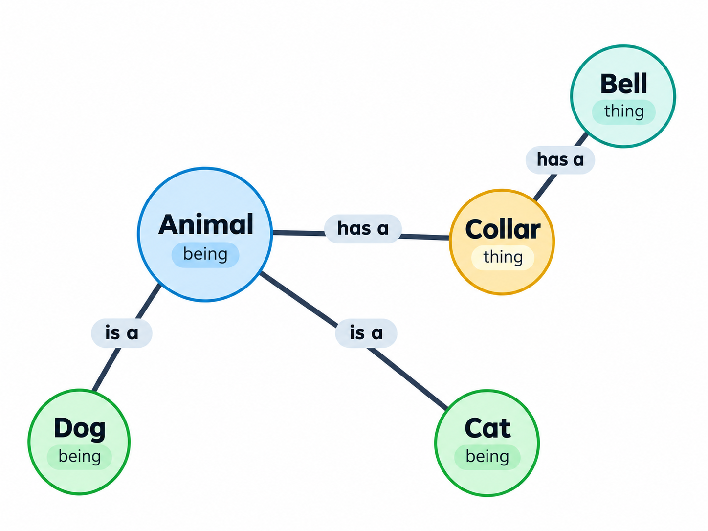

Not gonna lie, I hate **knowledge graphs**. Not long ago, this post would have been about why they're terrible (and
they are, there's truth in this). But I've come to realize that there's some very **good reasons** to use knowledge 
graphs in AI. I'll walk you through my arc, maybe you can appreciate them too.

## What's a KG?
A knowledge graph (KG) is a special type of graph database where the nodes are **entities** (nouns) and the edges are
**relationships**. Typically both the entities & relationships also can have **properties**.

_Narrator: Yo, it's not necessary to legit use a graph DB engine, SQL works fine for almost anyone._

The promise of KGs was that they can express logic that you can do proofs on, or infer results that might not
have been obvious at first. It's a **rich**, **flexible** data model around potentially gnarly domains. Also, you 
can use them to ground LLMs.

## Why don't I like them?
They're not bitter lesson pilled.

The [Bitter Lesson][bl] was an essay to AI researchers stating that the methods that work best in AI are those
that get better as **compute improves**. 

I've commonly conflated the Bitter Lesson with agents — if you're building
an agent and a new model drops that's 2x as good, does your agent also get 2x as good? If not, then your design
isn't Bitter Lesson pilled and you'll fall behind quickly. It follows the same logic as the Bitter Lesson, but 
technically incorrect. 

Models are getting better regardless if you want them to, no effort on your part. Like a force of nature. So
effort is better spent on **multiplying** LLM **gains** (that will happen anyway) rather than trying to big-brain the 
smartest solution.

Knowledge graphs are notoriously difficult to construct. They frequently take PhD-level experts and lots of
design to get the KG schema (ontology) constructed well. The Bitter Lesson directly **warns against** methods that 
require investing in complex designs (yes, knowledge graphs).

## Brittleness
You can tell you're dealing with a system that's not Bitter Lesson pilled when you bump into incorrect assumptions
about the real world. Things don't feel right, broken.

The problem with knowledge graphs is they're inherently limited to what a single human can conceive, and usually
far more limited than that. Like with code. Code that has a lot of `if` statements and **edge cases** gets super
complex real fast. Same with knowledge graphs for a really similar reason, you're effectively hand-coding the
domain, so it all has to fit into someone's head.

And so they're lossy. Read any good book on designing ontologies or knowledge graphs and this is the first thing
 — they convince you to accept that it **can't be perfect**, so just focus on the highest value things.

Which is where the problems stem from. The "highest value thing" is what someone somewhere (more likely, a committee
of people) thought was the most valuable, and frequently misses a thing you thought was important.

## But they're good
Alas, I **do like** knowledge graphs! They're really good when you need systematic repeatable completeness. 

For example, ARTEX (not giving you a direct link
because it's an offensive cybersecurity tool, but [here is an example of it being used][artex]). It uses two
graphs (technically not knowledge graphs). One graph keeps track of **assets** like IP addresses, apps, services,
ports, etc. The other graph is for **exploration** and stores things like goals, findings, observations, etc.

ARTEX is basically a very Claude Code like tool that uses these graphs to fan out and completely saturate every
asset with **every possible** vulnerability in effort to find a way in.

I've started using a KG-like graph for tracking AI news & developments. It's got:

* _**Entity types:**_ Person, Organization, Model, Software, Hardware, Research Artifact, Policy, Place, Concept, Security Incident, Security Issue, Mitigation
* _**Relationship types:**_ has metric, compared with, released, developed by, criticisizes, questions, affects, comments about, predicts, mitigated by, announces, reports, advocates, recommends, uses method, proposes, supports, assesses, has price, has failure, restricts

One of the core principles with this project is that it doesn't store facts, it just stores observations.
The factuality is determined at query time.

The most exciting thing that happened with this was that I told an agent to "let me know if anything **surprising** happens", where
_"surprising"_ is defined as anything that **conflicts** with the conventional knowledge of the graph. It proceeded
to spend the next 12 hours giving me updates on truly surprising things that I wouldn't have otherwise caught.

This stuff is easy with graphs.

In the past
I've tried to get agents to do this with just plain-text storage and it's just really hard. To do it well, you have
to add so much prompting to describe what _"surprising_" looks like that you've **effectively designed** a KG ontology.
So even though it's just relying on LLMs, it doesn't feel any more Bitter Lesson pilled.

## Where KGs work best
Current LLMs seem to do poorly with **systematically** listing ideas or processing edge cases & states.

If you want it to check for _"all the bad things"_, they do
a whole lot better if you give **them a list** of all the things you consider bad. At least it gives you a lot 
more consistent behavior. It's possible, just not great.

KGs work best when they're **filling in** for the weaknesses of LLMs. If you only store prose journal entries, they'll
inconsistently find observations of a certain type. Part of the problem is every time you have to re-evaluate
the list, the LLM has to completely re-discover the observations. And that re-discovery introduces fluctuations
in behavior.

## Will this change?
I'm not sure. It's hard to predict where AI is going to go next.

One thing on my mind is that KGs can be processed via code. And code is hella **cheaper and faster** than any 
LLM interaction will ever be. 

I have a theory that the general public, in the long run, may rarely interact directly with
AI. Instead, they'll interact with code that's written, maintained, and operated by AI agents. They still get that
dynamic feel, because the code quickly adapts to what they need. But it's fundamentally just code.
KGs are analogous to data-level code, and so they're a great tool for AI to inject it's own intelligence into 
plain code.

I have no idea if that's a realistic future, but there's good reasons to think it might be. It's certainly cheap
and a whole lot more scalable.

When predicting which technology or technique wins out, a lot of times it's actually social factors that determine
fate. And in this case, those social factors could just be that KGs are cheap and scalable. And using AI to maintain
the KG would convey most of the dynamism benefits.

## Conclusion
Well anyway, do what you want. Be cautious with knowledge graphs. Be bitter lesson pilled. But also be aware of LLM
weaknesses. They could be a good solution!

[bl]: http://www.incompleteideas.net/IncIdeas/BitterLesson.html
[artex]: https://workos.com/security/bulletins/october-30th-2026-data-security-incident
